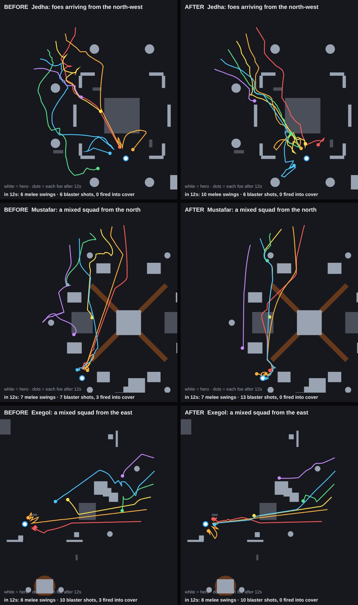
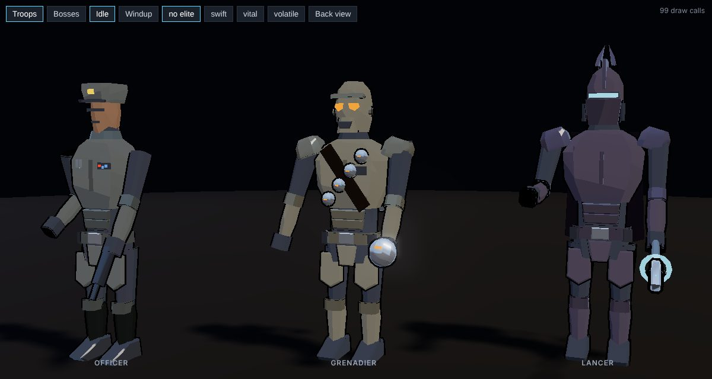

# Enemy AI

How grounded enemies find their way to the hero, and the knobs to tune it. Combat timing (wind-ups, swings, attack
tokens) is unchanged by this and lives in `src/data/enemies.js` (`ENEMY_TYPES`, `ENGAGE`).

## Pathing

| File | Holds |
|---|---|
| `src/enemies/nav.js` | The nav grid and flow field. `buildNav()` runs after every arena build; `updateNav()` refreshes the field toward the hero; `navSteer()` gives a foe its heading. |
| `src/enemies/ai.js` | `updateEnemies()`: uses `navSteer()` in the chase, the fuse rush, the ranged flank, and the stuck check. |
| `src/enemies/director.js` | Hands melee attack tokens to the foes closest by **walking** distance. |

- The grid is 0.6 units a cell. Each cell stores its clearance to the nearest real solid; climbable steps don't count,
  so foes still walk up the Jedha dais and the catwalks.
- Two body sizes path separately: troopers need 0.62 of clearance, brutes and other big bodies (radius above 0.85)
  need 0.95. Keep cover gaps wide enough for a brute (see `world-guidelines.md`).
- A foe walks straight at the hero whenever that line is open. Only when cover or a live hazard is in the way does it
  follow the field, aiming at the farthest point down it that it can reach in a straight line.
- Hazard zones and vents cost extra from just before their warning until they stop firing, so foes walk around a lava
  surge. They are never walls: a foe still crosses when there's no other way, and Push and kicks still throw them in.
- The flow field ignores flyers (jet troopers) and mind-tricked allies; they steer as before.

## Movement

Troopers move with the hero's ground handling and legs, so they read as people rather than sliding statues.

- Momentum (`enemies/ai.js`, the chase): speed builds at the hero's `MOVE.accel`, stopping or turning back brakes at
  `MOVE.brake`, and reversing hard at speed plants the feet for a pivot. The body turns at the hero's capped turn rate
  (faster once it's in the fight). Any other state (a windup, a stagger) starts the chase again from a standstill.
- Legs (`enemies/gait.js`): each leg is three bones (hip, knee, ankle) that skin the body's own mesh (`kit.js`
  `k.bone`), so they add no draw calls. They play the hero's motion-captured stride from how far the unit actually
  moved, with planted-foot locks and leg IK, so every state that moves a trooper (the chase, a lunge, a fuse run, the
  pursuit quarry) gets real footwork. The prowl round the ring is the captured walk; the charge is a run. Standing,
  feet stay put and step when the body moves or turns off them. Each foot stands on what is under it and the hips
  sink to the lower one; the body bobs with the stride and leans with acceleration.
- Jet troopers and leaps hang their legs; knockdowns, ragdolls and get-ups let them go straight.

## Behaviours

- **Stuck check:** a chasing foe that covers less than a third of the ground it tried to in half a second sidesteps
  toward the more open side for 0.6s, then re-routes.
- **No swings through walls:** a melee foe won't wind up on the far side of cover taller than 1.3; it keeps walking
  around. Low cover can still be struck over.
- **Ranged troopers:** out of range they advance along the field. In range with no shot they hide behind cover and
  peek; after 3s they flank for 4s to find a clear shot instead of firing into the wall.

## Attack turns

Melee foes take turns, the way Arkham and Fallen Order fights work (`ENGAGE` in `src/data/enemies.js`,
`src/enemies/director.js`).

- At most **two** melee foes hold an attack token at once (Padawan: one). Deeper waves and survival don't add more.
- Everyone else stalks a ring `ringPad` beyond its reach, circling with its guard up, and never swings from there.
- When a turn ends (the holder swings, is staggered or floored, dies, or gives up after `tokenHold`), the next foe
  closest by walking distance steps in after a short `handoff` beat (0.9s Padawan, 0.55s Knight, 0.3s Master).
- Ripostes and a feint's real follow-up need a turn too: with both slots taken, the foe backs off instead.
- Bombers, the Warbringer and ranged foes aren't in the queue; ranged foes have their own firing slots.

## Duelling

Sword-armed foes with a profile in `DUEL_PROFILES` (`src/data/duel.js`) fight like duellists. The code is
`src/enemies/duel.js`; `ai.js` calls into it when a foe commits to a swing, every wind-up and strike frame, and once a
frame per living duellist.

- **Guard:** a duellist covers one line (left, right or high from the hero's view) and holds its weapon there. Magnaguards
  and Sith acolytes also show a pale arc on that side. A cut on the covered line is turned at the profile's `block`
  chance, other lines at a fraction of it (`DUEL.offLine`). The line a cut comes in on is where its swing starts
  (`cutLine()`): D starts on the left, A on the right, W and finishers come down high.
- **Reading you:** the same line twice in a row and the guard locks onto it (amber arc, `READ YOU`) until you change it.
- **Posture:** each turned blow adds strain (more for finishers and Djem So, a lot for a kick or a jet charge). Past the
  profile's `posture` the guard breaks: the foe staggers, wide open. Posture drains back when left alone.
- **Offence:** each swing is planned when it starts: its line (shown by the wind-up pose), whether it is a feint (it
  switches side at `DUEL.feintAt` and comes in fast, so a reflex parry whiffs), a held strike (waits at the apex), a
  thrust (white tell; a held block can't stop it, parry or dodge), and how many cuts follow in the string.
- **Counter:** a foe that turns a blow may answer at once, but only if it holds or can take a free attack turn.
- **Saber lock:** your cut meeting a duellist's strike mid-arc binds the blades (`LOCK`). Mash LMB to drive through, or
  break it with a kick (stamina) or a Force push (Force). Win and the foe reels with your riposte ready; lose and its
  blade gets through.
- **Bolts:** acolytes bat blaster fire back at the shooter from the front.

`window.GAME.duel` exposes the tables and the lock in the dev console.

## Hitboxes

Every attack that touches a foe tests the same body: `src/enemies/bodyshape.js`, with each model's shape in
`src/data/bodyshape.js` (legs, torso with the arms, head), measured off the models. The shapes live in the model's own
space, so they turn, scale (elites too) and tip over with it.

- Blaster bolts, rockets, whistling birds and detonators sweep their whole step each frame, so a fast shot can't pass
  through a body, and they hit the first body along their path. Only the head band is a headshot.
- The Mandalorian's crosshair converges on the body it's over, using the same shape.
- Blasts measure to the nearest point of the body, not the feet. Cones and rings (Force push, pull, slam, repulse,
  judgement, the flamethrower, the darksaber slash, the spear) reach any part of the body inside them.
- The saber blade tests the points it sweeps through against the same shape.

Open the game with `?hitbox` in the URL to draw every foe's hitbox as a wireframe (yellow = head).

## Checking it

`window.GAME.nav` exposes the grid (`NAV`), `navSteer` and `navDist` in the dev console. `NAV.dist[0]` is the
trooper field and `NAV.dist[1]` the big-body field: walking distance to the hero per cell, row by row from −half.

## Tactics and squad roles

The data is `src/data/tactics.js`; the code is `src/enemies/tactics.js` (plus `src/enemies/grenades.js`). `ai.js` calls
into it at the same points it calls `duel.js`. `window.GAME.tactics` exposes the tables in the dev console.

- **The ramp:** every trick below scales with run depth (`RAMP`): about a third of its chance on wave 1, all of it by
  wave 9 (campaign waves add up across levels; survival uses the survival wave), times the difficulty.
- **Rank-and-file feints and held swings:** purge troopers and sentinels have `feint` and `delay` in their duel profile
  with `ramp: true`. Brutes and lancers (no duel profile) use `TROOP_MELEE`: a held swing hangs and trembles at the apex,
  a feint checks the swing, settles back, then comes again fast.
- **Blaster fire:** line troopers (blasters, jet troopers) sometimes fire a double-tap (a second bolt 0.16s behind) or
  hold their aim a beat longer (`TROOP_FIRE`).
- **Pincers:** when a second foe takes an attack token while another holder closes from the same side, it swings wide
  to come in from an angle off the first (`PINCER`). Rear wind-ups still get the longer tell.
- **Officer:** hangs back with a sidearm and calls an order every 6 to 9 seconds with you in sight (one order on the
  field at a time). The arm goes up and the call shows over its head for 0.7s; a hit in that window cuts it off.
  *Volley*: every line trooper near it and in range aims on the same beat and fires together. *Flank*: for 7 seconds
  every token holder swings wide around you. An officer's death makes the troops within 13 units falter for 1.3s.
- **Grenadier:** lobs a thermal detonator over cover onto where you're heading (`GRENADE`). The ring at the landing spot
  appears as it leaves the hand and fills as the fuse burns. The blast can't be blocked or parried; dash through it or
  get out. A stray one flinches the squad; a Jedi's Force Push sends live ones back into them for real damage.
  Grenadiers have their own fire slots, so they don't crowd out the blaster line.
- **Purge lancer:** an electro-pike gap-closer. From 5 to 12 units away, in front of the camera and in sight, it plants
  and marks a line on the ground at you (`LUNGE`). The line tracks you, turns white and locks at 70% of the tell, then
  it dashes down it. A held block can't stop the point: step off the line, dash, or parry (it staggers). A miss
  overshoots into a long recovery. One lancer lunges at a time, and one waiting its turn in the ring doesn't.
